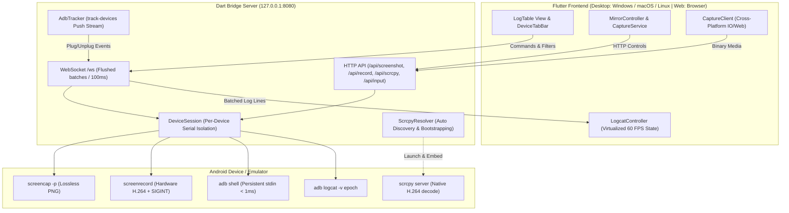

# ThruWire Architecture Specification

`ThruWire` is a high-performance, low-overhead Android companion tool designed for streaming and filtering `adb logcat`, capturing screenshots, mirroring screens with scrcpy, and recording device video across multiple devices.

---

## 1. High-Level System Overview



```text
┌────────────────────────────────────────────────────────┐
│                   Flutter Frontend                     │
│  (Desktop: Windows / macOS / Linux  |  Web: Browser)   │
└───────────────▲────────────────────────▲───────────────┘
         Control & Logs (WS)         scrcpy native client
         JSON Batches / 100ms        H.264 decode and display
                │                                │
┌───────────────▼────────────────────────────────▼───────┐
│                  Dart Bridge Server                    │
│   (Loopback 127.0.0.1 : 8080 | Embedded or Standalone) │
│                                                        │
│  ┌──────────────────────────────────────────────────┐  │
│  │           AdbTracker (Push-based)                │  │
│  │  Streams `adb track-devices` for real-time plug  │  │
│  └──────────────────────────────────────────────────┘  │
│                                                        │
│  ┌──────────────────────────────────────────────────┐  │
│  │         DeviceSession (Per-Device Serial)        │  │
│  │  - Isolated ring buffer (100,000 lines)          │  │
│  │  - Dedicated `adb logcat -v epoch` process       │  │
│  │  - Persistent `adb shell` for < 1ms input        │  │
│  │  - Native `screenrecord` with SIGINT finalizer   │  │
│  │  - On-demand single screenshots                  │  │
│  └──────────────────────────────────────────────────┘  │
│                                                        │
│  ┌──────────────────────────────────────────────────┐  │
│  │       ScrcpyResolver (Auto Bootstrap)            │  │
│  │  Discovers system scrcpy or auto-downloads       │  │
│  └──────────────────────────────────────────────────┘  │
└───────────────────────────▲────────────────────────────┘
                            │
               Native Subprocesses (ADB CLI)
                            │
┌───────────────────────────▼────────────────────────────┐
│               Android Device / Emulator                │
└────────────────────────────────────────────────────────┘
```

---

## 2. Core Architectural Principles

### 2.1 The "Dumb Pipe" Host Principle
Video transcoding on the host CPU is computationally expensive. ThruWire treats the Dart bridge as a **dumb pipe**:
- The bridge never runs ffmpeg, OpenCV, or software video re-encoding on the host.
- Video recording uses the device's native hardware encoder (`screenrecord`). The bridge sends `SIGINT` (`pkill -2 screenrecord`) on the device, waits for MP4 container finalization, and pulls the completed MP4.
- Live mirroring uses scrcpy's device-side H.264 encoding and native client decoder. On Windows, the native scrcpy window is hosted inside the mirror pane; other desktop platforms open scrcpy in its own window.

### 2.2 Transport Separation
Text logs and scrcpy video use independent transports:
- **Logcat & Control**: Batched JSON messages over `ws://127.0.0.1:8080/ws` flushed every 100ms.
- **Screen Mirror**: scrcpy manages its own video transport and decoding. The bridge does not capture or forward repeating screenshots.

### 2.3 Strict Session Isolation
All device state is encapsulated in `DeviceSession`:
- No global device assumptions.
- Each device maintains its own process handles, PID resolution, package filters, log buffer, and recording state.
- Disconnecting a device automatically cancels all associated streams and kills child processes.

---

## 3. Layer Breakdown

### 3.1 Presentation Layer (`lib/features/`)
- **`logcat/`**: Virtualized, high-throughput log viewer (`LogTableView`, `LogRow`). Built with custom viewport renderers to handle 100,000+ lines at 60 FPS without memory bloat. Includes `TopFilterBar`, `ColumnConfigDialog`, `PresetsDialog`, and `LeftVerticalToolbar`.
- **`mirroring/`**: Touch-interactive screen canvas (`ScreenMirrorView`), screenshot preview dialog (`ScreenshotDialog`), and automated scrcpy installation sheet (`ScrcpyInstallDialog`). Embeds native window on Windows via Windows runner MethodChannel.
- **`devices/`**: Multi-device tab bar (`DeviceTabBar`) and multi-screen grid layout (`MultiScreenGrid`) enforcing the 2-stream concurrency hard cap (`kMaxConcurrentStreams = 2`).

### 3.2 State & Controller Layer
- **`LogcatController`**: Manages view state, search queries, severity filters, column configuration, and per-device tab state (`DeviceTabState`). When the app is minimized or hidden, it enters **Background Mode**, buffering logs in memory without rebuilding the UI widget tree.
- **`MirrorController`**: Starts scrcpy on demand, forwards touch/key/text inputs to the bridge, and tracks mirror pane lifecycles.
- **`CaptureService`**: Coordinates single-shot screenshots and hardware video recording with toolbar badge countdowns.
- **`CaptureClient`**: Cross-platform abstraction (`capture_client_io.dart` and `capture_client_web.dart`) that handles HTTP media streaming and triggers native file download dialogs across desktop file systems and web browsers.

### 3.3 Bridge Management (`lib/bridge/`)
- **Conditional Compilation**: Uses Dart conditional imports (`bridge_manager_io.dart` vs `bridge_manager_stub.dart`) so the app compiles seamlessly to native desktop executables and pure Web (WASM/JS).
- **Desktop**: Automatically spawns and manages `LogcatBridgeServer` inside the application process.
- **Web**: Connects to the standalone bridge server via WebSocket/HTTP on `localhost:8080`.

### 3.4 Process & ADB Runner Layer (`lib/bridge/server/runners/`)
- **`ProcessRunner` Interface**: Abstraction over `dart:io Process` allowing complete unit and integration testing without requiring real hardware or ADB binaries via `FakeProcessRunner`.
- **`AdbTracker`**: Listens to `adb track-devices` stdout rather than polling `adb devices` on a timer, eliminating idle process fork overhead.
- **`ScrcpyResolver`**: Detects local `scrcpy` executables across system `PATH`, standard package manager locations (Chocolatey, Scoop, Homebrew), and `%LOCALAPPDATA%\ThruWire\tools\scrcpy`. Provides automatic on-demand archive downloading and unpacking.

---

## 4. Performance & Memory Engineering

| Constraint | Strategy |
|---|---|
| **< 2% Idle CPU** | Push-based `track-devices`, periodic flush timer (100ms), no busy loops or polling. |
| **Low mirror overhead** | Video is encoded on-device and decoded by scrcpy; the bridge does not capture or decode a frame loop. |
| **< 100MB RAM** | Global `StringPool` deduplicates repeated log tags and package strings. Inverted index for O(1) incremental filter evaluation. |
| **Multi-Device Hard Cap** | Strict 2-session scrcpy cap. Other grid tiles display static screenshot thumbnails. |

---

## 5. Security Architecture

1. **Loopback Only**: Server binds exclusively to `InternetAddress.loopbackIPv4` (`127.0.0.1`).
2. **CSWSH Defense**: Checks the HTTP `Origin:` header to block cross-origin browser requests from external websites.
3. **Serial Whitelisting**: Strict regex `^[a-zA-Z0-9._:-]{1,64}$` disallowing dash prefixes (`-`) prevents shell flag injection.
4. **Shell Sanitization**: Control characters are stripped and single quotes are escaped for POSIX shell execution before passing text to `input text`.
5. **Token Authentication**: Optional cryptographically secure random session token (`--auth` / `--token`) prevents unauthorized local processes from interacting with the bridge.
